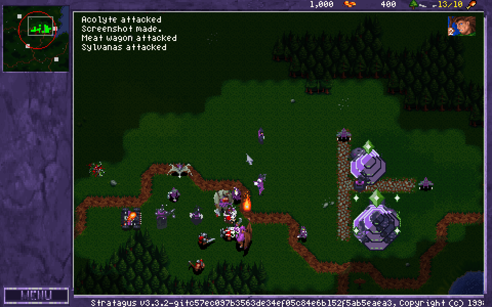
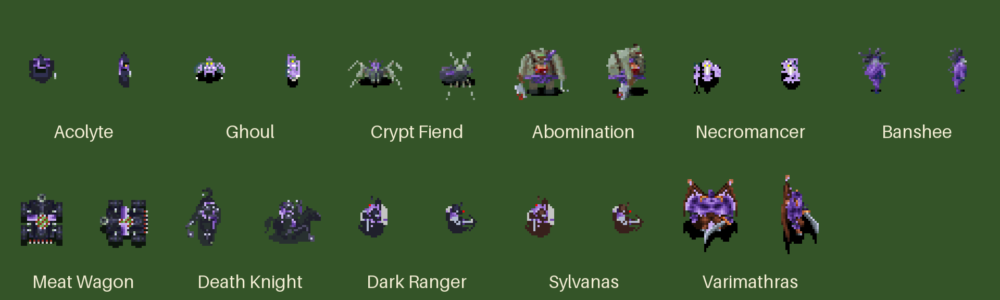
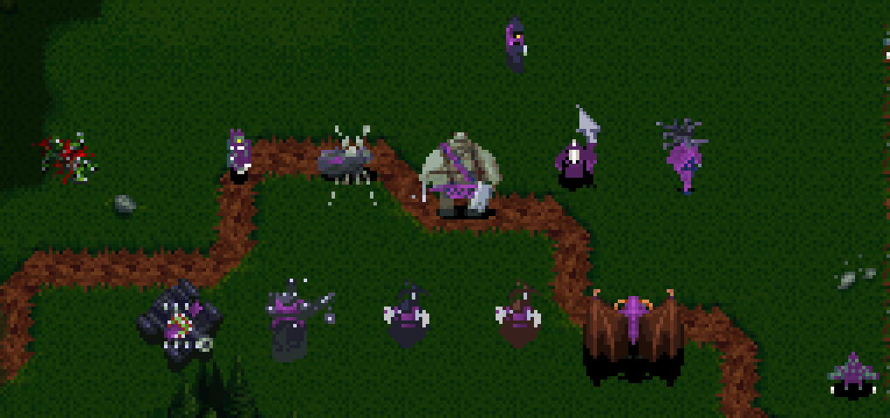

# Scourge: an Undead race for Warcraft: Orcs & Humans

A mod for [War1gus](https://github.com/Wargus/war1gus) (the Stratagus remake of Warcraft I). It adds a third playable race: the Undead Scourge. It comes with its own 12-mission campaign and a few skirmish maps.



## Why this exists

This is just a mind fart, to see if I could do it. I love Warcraft I, and as a kid I always imagined an undead campaign. That only came with Warcraft III. So there it is. Do with it as you please.

## What's in it

- **A third race, the Scourge**, playable in the campaign and in skirmish and multiplayer games. It has its own units, buildings, icons, team colours and sounds.
- **A 12-mission campaign**, from Tirisfal Outpost to Capital City, with narrated briefings.
- **4 skirmish/scenario maps**: Scourge Invasion, Blight of Black Morass, War of Three Races and Plague of Lordaeron.
- **Spells from Warcraft III:**
  - **Necromancer:** Raise Dead, Dark Vision, **Death Coil** (heals a friendly unit, or hurts an enemy).
  - **Banshee:** Summon Spiders, Plague Cloud, **Possession** (permanently takes control of an enemy unit).





**Units** (Scourge name, with the orc/human unit it replaces): Acolyte (worker), Ghoul (grunt/footman), Crypt Fiend (spearman/archer), Abomination (raider/knight), Meat Wagon (catapult), Necromancer (necrolyte/cleric) and Banshee (warlock/conjurer). The heroes are Sylvanas, the Death Knight, the Dark Ranger and Varimathras.

## What you need

- **War1gus 3.3.2** with **Stratagus 3.3.2**. On Windows, the War1gus download already includes Stratagus. On Arch Linux: `paru -S war1gus`.
- **Your own copy of Warcraft: Orcs & Humans** (CD or GOG), specifically the folder that contains `DATA.WAR`, or the GOG installer.

**No Blizzard game data is included in this repository.** War1gus extracts it from your own copy of the game.

## Installation on Windows

1. **Install War1gus.** Download it from the [War1gus 3.3.2 release page](https://github.com/Wargus/war1gus/releases/tag/v3.3.2). There are two versions:
   - `War1gus-3.3.2.exe`: a normal installer.
   - `War1gus-portable-3.3.2.exe`: unpacks everything into a single folder you choose, for example `C:\Games\War1gus`. This is the easiest to mod.
2. **Start War1gus once.** It asks where your Warcraft I data is. Point it to the folder with `DATA.WAR`, or to the GOG installer. Let it finish extracting, then close the game.
3. **Find the War1gus data folder.** This is the folder that now contains `graphics`, `scripts`, `campaigns` and so on:
   - **Portable version:** the folder you unpacked War1gus into, for example `C:\Games\War1gus`.
   - **Normal installer:** `Documents\Stratagus\data.War1gus`.
4. **Download this mod.** On this GitHub page, click **Code → Download ZIP** and unzip it.
5. **Copy the mod into the data folder.** Copy everything inside the unzipped `war1gus-scourge-main` folder (`campaigns`, `contrib`, `graphics`, `maps`, `scripts`, `sounds`, …) into the data folder from step 3. When Windows asks, choose **Replace the files in the destination**.
6. **Play.** Start War1gus as usual. Choose **Scourge campaign** in the campaign menu, or pick the **Scourge** race in a skirmish game.

If War1gus ever extracts the data again (for example after updating War1gus), its original scripts overwrite the mod's changed scripts. In that case, repeat step 5.

## Installation on Linux

```sh
# 1. Make a folder for the modded game and copy the War1gus scripts into it.
#    (/usr/share/games/stratagus/war1gus is the Arch path; it may differ on your distro.)
mkdir ~/wc1-scourge
cp -r /usr/share/games/stratagus/war1gus/. ~/wc1-scourge/

# 2. Extract your original Warcraft I data into that folder.
#    -m also converts the music (optional, takes a while).
war1tool -m /path/to/your/warcraft1/DATA ~/wc1-scourge

# 3. Put this mod on top.
git clone https://github.com/4a6f62/war1gus-scourge.git
cp -r war1gus-scourge/. ~/wc1-scourge/

# 4. Play.
stratagus -d ~/wc1-scourge
```

Pick **Scourge campaign** in the campaign menu, or choose the **Scourge** race in a skirmish game.

## Recommended: patch Stratagus (fixes a crash at the end of a mission)

Stratagus 3.3.2 (and current upstream) has a bug: if a worker dies while carrying a harvest order, the game can crash with `double free or corruption` when the mission ends. The same happens when a building's rally point is on a gold mine that has collapsed.

- The mod includes a Lua workaround for the rally-point case (`scripts/engine_fixes.lua`).
- Dead workers can only be fixed in the engine itself. `patches/stratagus-dangling-orders.patch` does that.

To build Stratagus with the patch:

```sh
git clone https://github.com/Wargus/stratagus.git
cd stratagus
git checkout c57ec097b3563de34ef05c84e6b152f5ab5eaea3   # the 3.3.2 version the patch was tested on
patch -p1 < /path/to/war1gus-scourge/patches/stratagus-dangling-orders.patch
mkdir build && cd build
cmake .. -DCMAKE_BUILD_TYPE=Release -DCMAKE_POLICY_VERSION_MINIMUM=3.5
make -j"$(nproc)"
./stratagus -d ~/wc1-scourge
```

On Arch you can add the `patch -p1` line to the `prepare()` step of the stratagus PKGBUILD instead.

**On Windows** there is no patched Stratagus build yet; building one needs Visual Studio and is beyond a quick guide. Without the patch the mod still works, but this crash can occasionally happen when a mission ends. Saving shortly before you win lets you redo the ending if it does.

## Rebuilding the art and sounds (optional)

The sprites, icons, sounds and campaign files are generated by the Python scripts in `scripts/`, for example:

- `build_forsaken_art.py`, `build_spell_icons.py`
- `build_abomination.py`, `build_banshee.py`, `build_crypt_fiend.py` (the hand-tuned units)
- `build_forsaken_sounds.py`, `generate_campaign_voices.py`

They need Python 3 with Pillow, and `espeak-ng` + `ffmpeg` for the voices. The scripts have the original author's folder hard-coded in `BASE_DIR`; change it to your own folder before running them. `retrodiffusion_client.py` needs your own RetroDiffusion key in the `RD_API_KEY` environment variable.

Internally the race is still called `forsaken` (folder names, unit ids). The game itself shows "Scourge" everywhere.

## Credits

- **Antigrav**: idea, design, campaign and testing.
- **Claude** (Anthropic's AI assistant): code, the generated art and sounds, spells and bug fixes.
- **The Stratagus and War1gus teams**, for keeping Warcraft I alive.
- **Blizzard Entertainment** made Warcraft: Orcs & Humans and Warcraft III. This is an unofficial fan project, not affiliated with or endorsed by Blizzard.

## License

The modified War1gus scripts are under the GPL-2.0, like War1gus itself (see `LICENSE`). Everything else: do with it as you please.
